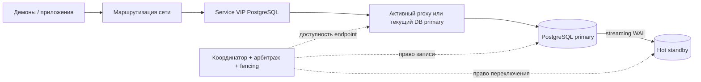
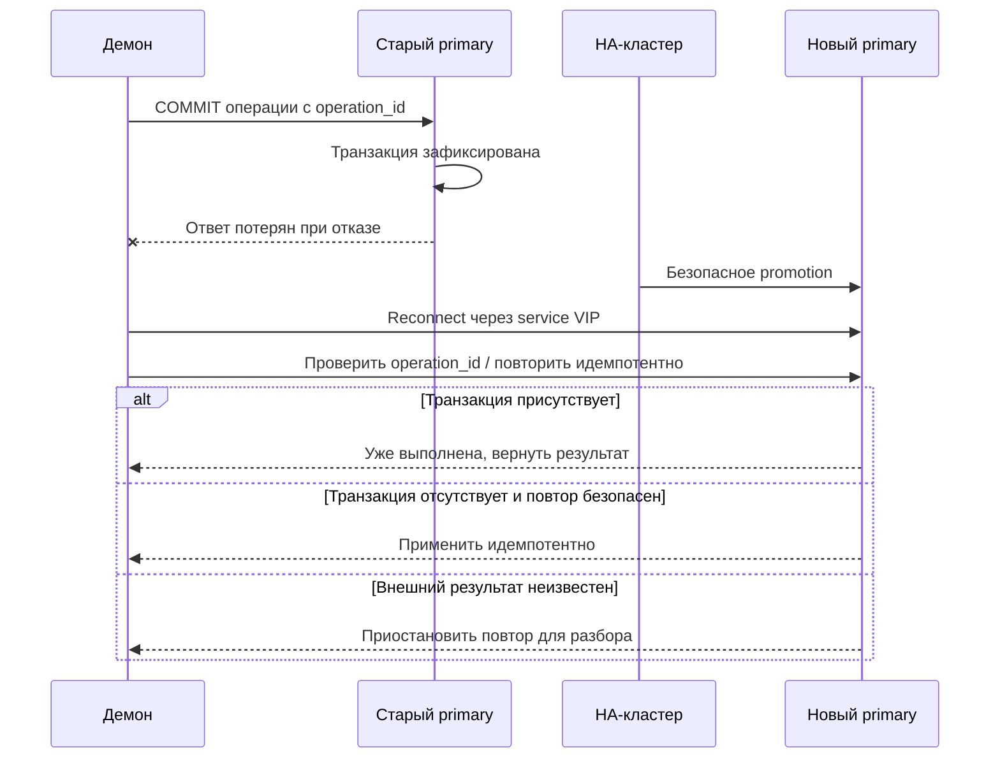

# Отказоустойчивый PostgreSQL: варианты архитектуры

Цель: два узла PostgreSQL в одной LAN, единственный primary, hot standby и автоматическое безопасное переключение БД, endpoint и зависимых демонов. После failover новый primary принимает запись без второй копии; старый узел возвращается только как standby, без автоматического failback. Hot standby применяет WAL в recovery и не является вторым сервером прикладной записи.

Документы описывают архитектуры, а не готовые конфигурации для production. ОС, версии PostgreSQL, модель роутера, размещение демонов и допустимые RPO/RTO пока неизвестны. Механизмы и параметры следует сверить с документацией выбранных версий и проверить на стенде. Численные сроки переключения намеренно не обещаются.

## Требуемое поведение

[00 — Поведение при отказах и краевых случаях](docs/00-required-behavior.md) описывает инварианты целостности, автоматическое переключение, работу демонов и возврат узлов без привязки к конкретным средствам. После безопасного переключения запись на новом primary разрешена даже без standby; деградированный режим и риск последующего отказа единственной копии должны быть явно видимы.

## Решения

| Документ | Координатор | Дополнительная инфраструктура | Основное ограничение |
|---|---|---|---|
| [01 — Patroni + etcd](docs/01-patroni-etcd.md) | Patroni, lease в DCS | 3 участника etcd, 2 proxy для HA endpoint | При потере кворума безопасная конфигурация ограничивает запись |
| [02 — Pacemaker + Corosync](docs/02-pacemaker-corosync.md) | Кластер ресурсов на двух узлах | Независимый STONITH; qdevice необязателен | Нужны корректная двухузловая политика, DB-агент и автоматизация rejoin |
| [03 — repmgr + fencing](docs/03-repmgr.md) | repmgrd + собственный admission gate | Fencing, интеграция endpoint/демонов; witness необязателен | Безопасность допуска и восстановления требует собственной разработки |
| [04 — pg_auto_failover](docs/04-pg-auto-failover.md) | Monitor + keepers | Отдельный monitor, proxy, защита изоляции | Monitor — отдельная точка зависимости для управления failover |

**Первый кандидат для текущих требований:** два узла Pacemaker + Corosync + проверенный STONITH, с БД, VIP и singleton-демонами как кластерными ресурсами. Patroni подходит при допустимости независимого кворума и отдельной интеграции демонов. repmgr — основа для собственного протокола допуска и восстановления. pg_auto_failover требует monitor. Все варианты должны обеспечивать прекращение старой записи до новой; наличие пакета само по себе не доказывает соответствие требованиям.

Два отдельных proxy-хоста не обязательны: endpoint может размещаться на DB-хостах при подходящей модели отказов. В двухузловой схеме независимое управление питанием или гипервизором остаётся инфраструктурной зависимостью, даже без отдельного наблюдателя.

## Что именно означает VIP и VRRPv3

VRRPv3 выбирает активный маршрутизатор для виртуального адреса в конкретном сетевом сегменте. Поддержка VRRP одним роутером не создаёт отказоустойчивости: нужен второй VRRP-участник. Она также не доказывает, что этот адрес можно безопасно переносить на Linux-серверы.

Возможны три разных схемы, которые необходимо согласовать с сетевой командой:

1. **VIP на DB-серверах.** Keepalived или кластерный ресурс перемещает адрес на текущий primary. Нужны подходящий L2-сегмент, разрешённые gratuitous ARP / unsolicited NA и отсутствие дублирования адреса. Владение VIP определяется уже принятым решением DB-кластера, а не заменяет его.
2. **VIP на двух proxy.** Keepalived управляет VIP, HAProxy направляет TCP только в проверенный writable primary. DB-серверы могут находиться в разных сегментах. Это основной сетевой вариант в документах 01, 03, 04.
3. **VIP на паре роутеров.** Это обычно адрес шлюза, а не PostgreSQL endpoint. Для подключения к БД дополнительно нужны поддерживаемые роутерами балансировка/DNAT и health-check либо маршрутизация service IP к HA proxy. Один VRRP не переключит TCP/5432 между БД. Проверить также симметрию маршрутов, синхронизацию NAT-state и поведение существующих соединений.

Не назначать один адрес одновременно группе роутеров и группе DB/proxy. Не считать `TCP/5432 открыт` признаком primary. На L2 предусмотреть VRRP (IP protocol 112), уникальный VRID, настройки multicast/unicast и фильтрацию; при IPv6 проверить Neighbor Discovery отдельно.

## Общие требования к безопасности

- Streaming replication: отдельный replication user, `pg_hba.conf`, TLS, WAL capacity, мониторинг lag. Initial base backup и затем непрерывная доставка WAL. Replication slots ограничить по удержанию WAL: отставший резерв не должен заполнить диск primary.
- **RPO:** асинхронная репликация может потерять подтверждённые транзакции. При синхронной репликации и `synchronous_commit=on` подтверждение ждёт durable WAL на выбранном standby; `remote_apply` дополнительно ждёт применения и увеличивает задержку. Гарантия относится только к транзакциям, реально исполнившим синхронную политику, и к продвижению соответствующего standby. Это не защита от общей потери дисков.
- **После безопасного failover одиночная запись обязательна:** новый primary не ждёт восстановления standby. Новые транзакции имеют одну копию; мониторинг показывает деградированный режим. Постоянное требование двух копий не соответствует текущей модели.
- Синхронная политика в нормальном режиме и поведение при потере только standby согласуются отдельно. При смене роли необходимо проверенно снять ожидание отсутствующей реплики. Нельзя обещать RPO=0 при последующем отказе единственной копии.
- **Split-brain:** новый primary разрешается только после доказательства эксклюзивного права записи и отключения/самоотключения старого. Наличие VIP только на одном сервере не мешает прямым подключениям к другому. Запретить приложениям обходить endpoint, но не использовать firewall как единственную замену fencing.
- **Без наблюдателя возможно, без безопасного допуска нельзя.** Двухузловой кластер может опираться на проверенное fencing и правила встречного переключения. Если выбран кворумный DCS, его третий участник должен находиться в независимом домене отказа; третий контейнер на одном DB-хосте не решает проблему.
- **Fencing:** BMC/IPMI, API гипервизора или аппаратный watchdog должны оставаться работоспособными при отказе data plane. Подтверждение отправки команды выключения не равно подтверждению изоляции. При отсутствии доказательства безопасности — остановить автоматический failover.
- Кандидат может повторно запрашивать demotion прежнего primary, но до однозначного подтверждения остаётся без права записи. Ответ должен подтверждать фактическую остановку записи и устойчивый запрет возврата роли; timeout не считается успехом. Если узел не отвечает, требуется независимая изоляция, иначе promotion блокируется.
- Вернувшийся бывший primary не запускать writable самостоятельно. Автоматический карантин → `pg_rewind` (если prerequisites выполнены) или новый base backup → запуск standby → проверка timeline/lag. Полное восстановление реплики не является условием открытия записи на новом primary.
- Failover не заменяет резервные копии: нужны backup + архив WAL, проверка PITR и защита от общей ошибки/удаления данных.

## Протоколы демонов и неоднозначный COMMIT

VIP сохраняет адрес, **но не TCP-сессию или транзакцию**. Все демоны должны поддерживать reconnect с ограниченным backoff и jitter, connect/read/write timeout, завершение зависших транзакций и проверку ролей. Длительность timeout согласовать с реально измеренным RTO.

Для команд во внешние системы нужен transactional outbox и идемпотентный получатель. Уникальный ключ только в БД не предотвращает повторную внешнюю команду, если эффект уже произошёл, а отметка о нём потерялась. Если демоны работают на обоих DB-хостах, для singleton-задач нужен отдельный lease/fencing либо кластерный ресурс с тем же владельцем, что у primary; PID процесса и факт владения VIP не являются распределённой блокировкой.

## Приёмочные испытания для всех вариантов

Измерять RTO от потери сервиса до успешной новой транзакции приложения; отдельно измерять время обнаружения, fencing, promotion, сходимость ARP/ND и reconnect. RPO оценивать по журналу подтверждённых `operation_id` до и после отказа.

| Испытание | Обязательный ожидаемый результат |
|---|---|
| `kill -9` PostgreSQL, падение DB-хоста | Подтверждённый отзыв роли → promotion → успешная запись на одной копии и reconnect |
| Разрыв только replication-канала | Нет двух primary; lag видим; синхронная запись ведёт себя по политике |
| Primary доступен приложениям, но изолирован от управления | Он прекращает запись/изолируется до открытия нового primary |
| Потеря witness/DCS/monitor | Нет необоснованного promotion; поведение явно задокументировано |
| Потеря standby | RPO/доступность соответствуют выбранной синхронной политике |
| Отказ fencing или подвисание ОС | Failover не открывает второй writable узел |
| Возврат старого primary | Без самостоятельной записи; автоматический rewind/reclone и standby, без failback |
| Запоздалый demote или сбой между шагами | Проверка поколения и фактической роли; безопасный повтор, без отзыва роли текущего владельца |
| Потеря proxy, VRRP partition, устаревший ARP | Endpoint восстанавливается; не выбирается старый primary |
| Заполненный WAL-диск, повреждение данных, большой lag | Ошибка обнаружена, небезопасный кандидат не продвигается |
| Потеря ответа COMMIT | Нет неконтролируемых повторов команд |

## Что уточнить перед реализацией

1. Версии PostgreSQL/ОС, VM или bare metal, наличие BMC/watchdog и независимой сети управления.
2. RPO/RTO, sync/async в нормальном режиме и политика при потере только standby. Одиночная запись после безопасного failover уже разрешена.
3. Два ли есть роутера, где расположен service VIP, что поддерживает оборудование кроме VRRP.
4. Возможность третьего независимого узла и двух proxy, L2/L3-топология и ACL.
5. Где работают демоны, какие операции нельзя повторять, есть ли прямые подключения к DB IP.
6. Резервное копирование, PITR, мониторинг и ответственность за ручное аварийное решение.

## Источники для проектирования

- [PostgreSQL: warm/hot standby и streaming replication](https://www.postgresql.org/docs/current/warm-standby.html)
- [PostgreSQL: synchronous_commit](https://www.postgresql.org/docs/current/runtime-config-wal.html#GUC-SYNCHRONOUS-COMMIT)
- [PostgreSQL: pg_rewind](https://www.postgresql.org/docs/current/app-pgrewind.html)
- [VRRPv3, RFC 9568 (заменяет RFC 5798)](https://www.rfc-editor.org/rfc/rfc9568.html)
- [Keepalived](https://www.keepalived.org/manpage.html)

Диаграммы записаны в Mermaid. Их можно просматривать в поддерживающем Mermaid Markdown-renderer. Источники указаны для проверки перед внедрением; онлайн-проверка документации в этой среде не выполнялась.
