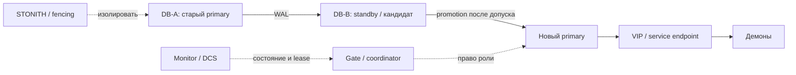

# Условные обозначения и термины

Документ объясняет термины и обозначения, используемые в архитектурах отказоустойчивого PostgreSQL. Он не задаёт отдельную технологию и не заменяет [требования к поведению](00-required-behavior.md).

## Основные роли базы данных

| Термин | Значение |
|---|---|
| **Узел** | Сервер, VM или другой вычислительный экземпляр, на котором работают PostgreSQL и управляющие процессы. В базовой схеме узлов два: A и B. |
| **Primary** | Текущий владелец роли записи. Принимает прикладные изменения и подтверждает транзакции в соответствии с выбранной политикой репликации. В каждый момент должен быть не более одного действующего primary. |
| **Старый primary** | Узел, который был primary до failover. После отзыва роли он не должен продолжать принимать запись или выполнять конфликтующие singleton-действия. |
| **Новый primary** | Бывший standby, который получил подтверждённое право записи после безопасного переключения. |
| **Standby** | Узел PostgreSQL в режиме recovery, принимающий и применяющий WAL от primary. Не принимает прикладную запись. |
| **Hot standby** | Standby, который может обслуживать допустимые запросы чтения во время применения WAL. Это не второй узел для записи. |
| **Кандидат** | Standby, рассматриваемый для promotion. До завершения проверок не имеет права записи и не считается primary. |
| **Владелец** | Узел, которому в текущем поколении роли разрешено обслуживать запись, endpoint и связанные singleton-демоны. Владелец не определяется только VIP или открытым TCP-портом. |
| **Карантин** | Безопасное состояние узла после запуска или возврата: нет прикладной записи, endpoint и конфликтующих singleton-демонов до определения роли. |
| **Деградированный режим** | Работа нового primary без standby после безопасного failover. Запись разрешена, но новые транзакции временно имеют только одну копию. |
| **Failback** | Автоматический возврат роли на прежний узел после его восстановления. В целевой модели запрещён: прежний primary возвращается как standby. |

## Репликация и данные

| Термин | Значение |
|---|---|
| **Streaming replication** | Непрерывная передача WAL от primary на standby по сети. |
| **WAL** | Write-Ahead Log, журнал предзаписи PostgreSQL. Содержит изменения, необходимые для восстановления и репликации. |
| **Timeline** | Ветка истории WAL PostgreSQL. После promotion может появиться новая timeline; расходящиеся ветки нельзя бездумно объединять. |
| **Replication lag** | Отставание standby по получению, сохранению или применению WAL. Важно различать эти позиции при оценке пригодности кандидата. |
| **Async replication** | Primary не ждёт подтверждения standby перед ответом клиенту. При отказе возможна потеря последних подтверждённых транзакций, ещё не дошедших до standby. |
| **Sync replication** | Подтверждение транзакции зависит от сохранения WAL на заданном standby согласно настройке. Уменьшает RPO, но может задерживать или блокировать запись при потере standby. |
| **RPO** | Recovery Point Objective, допустимый объём потерянных данных после отказа. RPO=0 означает отсутствие потери подтверждённых транзакций только в пределах реально выполненной политики и соответствующего сценария. |
| **RTO** | Recovery Time Objective, допустимое время восстановления работы. В этой задаче его следует измерять до успешной новой транзакции демона, а не только до момента promotion. |
| **Rewind** | Приведение старого узла к истории нового primary без полного clone, если выполнены необходимые условия PostgreSQL. Не объединяет конфликтующие изменения двух веток. |
| **Reclone / base backup** | Пересоздание standby из актуальной копии текущего primary, когда rewind невозможен или не подходит. |
| **PITR** | Point-in-Time Recovery, восстановление базы на выбранный момент из резервной копии и архива WAL. Защищает от логических ошибок и общей потери узлов, а не только от отказа primary. |

## Переключение и безопасность

| Термин | Значение |
|---|---|
| **Failover** | Аварийное переключение с недоступного или отозванного primary на standby. В целевой модели после безопасного failover новый primary принимает запись без standby. |
| **Switchover** | Плановое переключение, при котором старый primary доступен и корректно передаёт роль standby. |
| **Promotion** | Перевод standby в primary, то есть открытие права записи. Promotion нельзя выполнять только по timeout или отсутствию heartbeat. Сам PostgreSQL при promotion выходит из recovery; безопасное право на этот переход обеспечивает управляющая система. |
| **Demotion** | Отзыв роли primary и перевод узла в состояние, где он не принимает запись. При штатном demotion это может быть сетевой командой; команда должна быть подтверждена фактическим результатом. |
| **Fencing** | Принудительное лишение узла возможности работать в прежней роли: например, выключение питания через BMC или остановка VM через API гипервизора. Обычно выполняется до promotion нового primary. |
| **STONITH** | Термин кластерных систем для fencing через выключение или перезагрузку узла. Расшифровывается как «Shoot The Other Node In The Head». В документах означает средство принудительной изоляции, а не обычную остановку PostgreSQL. |
| **Watchdog** | Механизм, который перезапускает или отключает узел, если управляющий процесс перестал его обслуживать. Протокол HA связывает обслуживание watchdog с правом работать. Программный watchdog не обязательно защищает от зависания ОС; для такой модели отказов нужна проверенная аппаратная защита и гарантированные сроки. |
| **Graceful demotion** | Корректная передача команды старому primary на остановку записи. Полезна, но не заменяет fencing, если узел завис, недоступен или может вернуться к старой роли. |
| **Split-brain** | Состояние, в котором два узла считают себя primary и принимают независимые записи. Это основной недопустимый результат небезопасного автоматического failover. |
| **Exclusive admission** | Проверяемое право единственного кандидата стать primary. Доступность, VIP и успешный SQL-запрос сами по себе его не доказывают. |
| **Admission gate** | Логика или компонент, который выдаёт право на promotion после проверки роли, поколения операции, состояния кандидата и изоляции старого владельца. |
| **Generation / fencing token** | Номер поколения роли или монотонный токен допуска. Получатель обязан проверять его и отклонять устаревшие команды; сам номер без проверки не защищает от запоздалых действий. Идентификатор операции отдельно используется для безопасных повторов. |
| **Quorum** | Число голосов, необходимое для разрешения действий по правилам выбранной системы; для consensus-хранилищ обычно большинство. Двухузловой кластер без третьего голоса может использовать специальную политику и fencing. Одна недоступность peer не даёт безопасного права на promotion. |
| **Witness** | Дополнительный участник, который помогает оценить видимость узлов или выбрать сторону. Witness сам по себе не останавливает старый primary и не является fencing. |
| **Monitor** | Отдельный управляющий компонент, который хранит или назначает состояния узлов. Например, monitor используется в pg_auto_failover. Он не обязательно является consensus-кворумом и не заменяет fencing. |
| **DCS** | Distributed Configuration Store, распределённое хранилище состояния и блокировок, например etcd. Patroni использует DCS для leader lease. |
| **Leader lease** | Ограниченное по времени право узла быть лидером, которое нужно регулярно продлевать. Истечение lease не равно физической остановке старого PostgreSQL без дополнительной защиты. |

## Сеть и доступ к базе

| Термин | Значение |
|---|---|
| **Service endpoint** | Единая точка подключения демонов к текущему primary. Это может быть VIP на DB-узлах, VIP на proxy или DNS/маршрутизируемый адрес. |
| **VIP** | Virtual IP, виртуальный IP-адрес, который можно переместить между владельцами или направить через proxy. VIP упрощает подключение, но не выдаёт право записи. |
| **VRRP** | Протокол выбора владельца виртуального IP между участниками. VRRP переключает адрес, но не выбирает роль PostgreSQL и не сохраняет TCP-сессии. |
| **Keepalived** | Реализация VRRP и health-check, часто используемая для управления VIP. Не должна самостоятельно выполнять promotion базы по одному health-check. |
| **Proxy** | HAProxy или другой промежуточный TCP/SQL endpoint, который направляет новые подключения только к узлу с подтверждённой writable-ролью. |
| **Role-aware health-check** | Проверка роли и состояния узла, например подтверждение primary endpoint Patroni или согласованного admission gate. Проверка TCP/5432 недостаточна. |
| **L2** | Канальный уровень сети: обычно одна Ethernet-подсеть/VLAN. Упрощает перенос VIP, но не исключает отказ кабеля, порта, firewall или общего коммутатора. |
| **Network partition** | Сетевое разделение, при котором узлы или управляющие компоненты не видят друг друга. Узел при этом может продолжать работать и обслуживать клиентов. |
| **Management plane** | Канал управления: BMC, API гипервизора, кластерные heartbeat и административные команды. Он должен быть отделён или защищён от отказов data plane настолько, насколько это требуется для fencing. |
| **Data plane** | Основной путь прикладного трафика, репликации и клиентских подключений. Его отказ не всегда означает, что узел остановлен. |
| **GARP / unsolicited NA** | Сообщения IPv4 ARP или IPv6 Neighbor Discovery, которыми новый владелец сообщает сети об изменении MAC для VIP. Они обновляют соседние таблицы, но не переносят существующие TCP-сессии. |

## Компоненты вариантов

| Термин | Значение |
|---|---|
| **Pacemaker** | Менеджер кластерных ресурсов: может управлять PostgreSQL, VIP, fencing и singleton-демонами по constraints и ordering. |
| **Corosync** | Компонент membership и обмена сообщениями в Pacemaker-кластере. Не является сам по себе менеджером PostgreSQL. |
| **Resource agent** | Скрипт/агент, через который кластерный менеджер запускает, останавливает и проверяет ресурс. Для PostgreSQL критична поддержка promotion и streaming replication. |
| **Patroni** | Управляющий PostgreSQL-компонент, который использует DCS для выбора лидера, управляет репликацией и выполняет promotion/rejoin. Не является универсальным менеджером произвольных демонов. |
| **etcd** | Распределённое key-value хранилище, часто используемое как DCS для Patroni. Для переживания отказа одного участника нужен кворум из трёх участников в независимых доменах. |
| **repmgr** | Набор инструментов PostgreSQL для регистрации узлов, clone, follow, switchover, promotion и rejoin. Без собственного admission gate и fencing не гарантирует безопасность автоматического failover во всех сценариях. |
| **repmgrd** | Демон наблюдения и автоматизации действий repmgr. Его решения должны быть подчинены общей политике допуска к promotion. |
| **pg_auto_failover** | Специализированный стек PostgreSQL с monitor и keeper, реализующий машину состояний переходов. Для штатного автоматического failover требует доступного monitor. |
| **Keeper** | Управляющий процесс `pg_autoctl` в pg_auto_failover, который выполняет назначенные monitor действия на DB-узле. |
| **HA-кластер** | В данном документе не просто два сервера, а согласованная система ролей, допуска, изоляции, endpoint и восстановления. Репликация без этих механизмов — только резервирование данных. |

## Демоны и операции

| Термин | Значение |
|---|---|
| **Демон** | Фоновый процесс, который использует базу и может выполнять прикладные или внешние действия. |
| **Singleton-демон** | Демон или задача, которые должны работать только в одном экземпляре, связанном с текущим primary. |
| **Operation ID** | Устойчивый идентификатор прикладной операции, по которому после reconnect можно проверить, была ли она уже выполнена. |
| **Неопределённый COMMIT** | Ситуация, когда клиент потерял ответ после отправки COMMIT и не знает, зафиксирована ли транзакция. Нельзя считать её автоматически неуспешной и бездумно повторять внешний эффект. |
| **Reconnect** | Повторное подключение демона после отказа endpoint или TCP-сессии. VIP не сохраняет соединение. |
| **Backoff и jitter** | Ограниченная задержка перед повторными попытками, случайно изменяемая, чтобы демоны не создавали синхронный всплеск нагрузки. |
| **Transactional outbox** | Паттерн, при котором запись о внешнем событии сохраняется в той же транзакции, что и изменение данных, а отдельный обработчик доставляет событие повторно и идемпотентно. |
| **Идемпотентность** | Повтор операции приводит к тому же допустимому результату, а не к повторному внешнему эффекту. |

## Обозначения на диаграммах

В Mermaid-диаграммах используются следующие сокращения:

| Обозначение | Смысл |
|---|---|
| **A** | Обычно старый primary, который отказал, изолирован или возвращается после failover. |
| **B** | Обычно standby или кандидат, который может стать новым primary. |
| **N** | Новый primary после успешного promotion. |
| **D** | Демоны, приложения или клиенты. |
| **V** | VIP или другой service endpoint. |
| **G** | Логика координации и допуска к смене роли. |
| **F** | Механизм fencing/изоляции, который лишает старый узел возможности писать. |
| **M** | Monitor, DCS или другой источник состояния; конкретный смысл зависит от варианта. |
| `-->` | Обычный поток данных, вызов или зависимость. |
| `-.->` | Управляющее влияние или условная связь, не обязательно поток прикладных данных. |
| `--x` | Связь потеряна или действие не удалось. |
| `alt` | Альтернативные ветви сценария, например успешный и небезопасный исход. |
| `Note` | Уточнение инварианта или ограничение диаграммы, а не отдельный компонент. |

## Важные различия

### Репликация и отказоустойчивость

Репликация сохраняет изменения на другом узле. Отказоустойчивость дополнительно должна определить единственного владельца, безопасно переключить роль, направить клиентов и восстановить старый узел без двух primary.

### Наблюдение и изоляция

Наблюдение отвечает на вопрос «узел доступен с моей точки?». Fencing отвечает на вопрос «узел больше не может писать?». Для безопасного автоматического promotion второе требование важнее первого.

### VIP и роль базы

VIP говорит, куда направлять новые подключения. Он не доказывает, что принимающий сервер имеет право записи, не закрывает старые соединения и не останавливает локальные процессы.

### Demotion и fencing

Demotion — корректная команда узлу отказаться от роли. Fencing — принудительная защита от случая, когда команда не дошла, не выполнилась или узел позже вернулся к старой роли. В простом отказе возможен demotion; в неопределённом отказе требуется fencing или запрет promotion.

### Потеря standby и потеря primary

При потере standby текущий primary может продолжить работу, если политика это разрешает, но остаётся без второй копии. При потере primary standby может стать новым primary и продолжить запись. В обоих случаях мониторинг должен показывать деградированное состояние и фактический RPO-риск.
