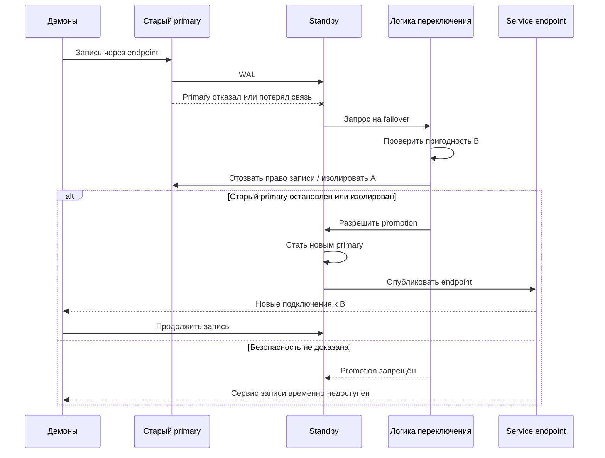
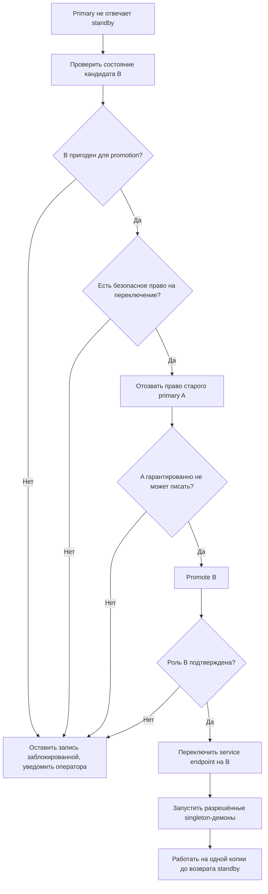
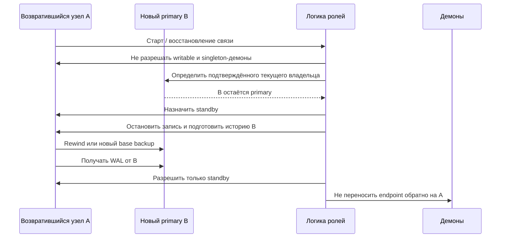
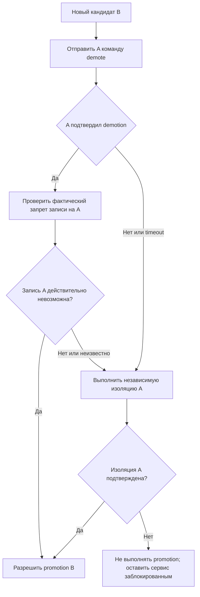
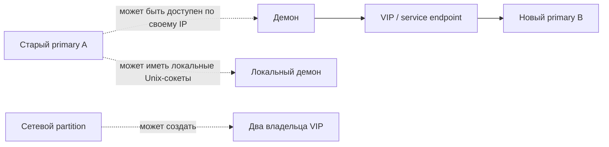
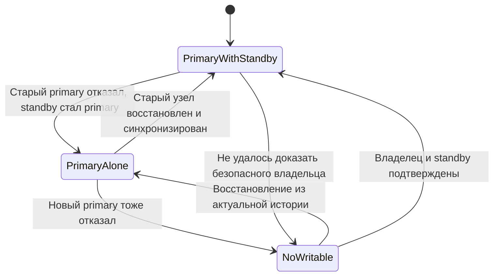
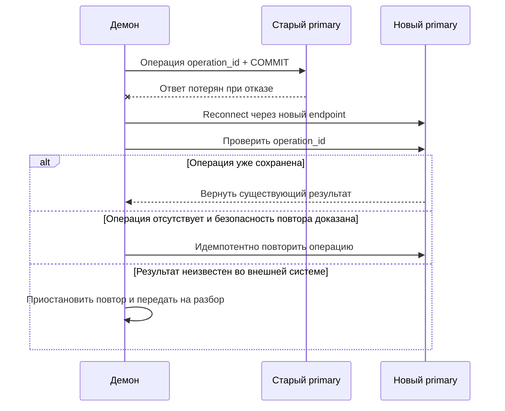
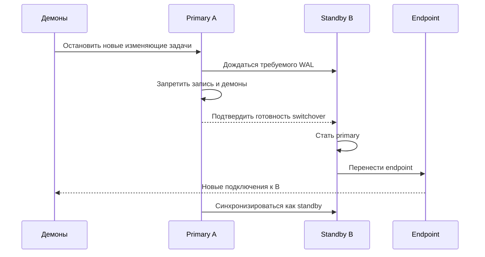

# Требования к поведению двухузловой HA-системы

## 1. Целевая модель

Есть два узла PostgreSQL в одной локальной сети:

- **текущий primary** — единственный узел, принимающий прикладную запись;
- **standby** — горячий резерв, постоянно получающий WAL и готовый стать новым primary;
- демоны подключаются через единый service endpoint, например VIP/VRRP;
- отдельный наблюдатель не является обязательным компонентом данной модели.

Цель — автоматическое переключение при отказе primary без появления двух владельцев записи.

Главный приоритет:

> **Целостность важнее доступности. В каждый момент времени допускается не более одного узла, который может принимать прикладную запись и выполнять конфликтующие singleton-действия.**

При этом после подтверждённого failover новый primary **должен продолжать принимать запись даже при временной работе без standby**. Это осознанный деградированный режим: новые транзакции в этот момент имеют только одну копию и могут быть потеряны при последующем отказе нового primary.

## 2. Требования к ролям

### 2.1. Primary

Primary:

- принимает прикладные записи;
- сохраняет право быть владельцем роли по проверяемому протоколу; конкретная реализация может использовать ограниченное по времени разрешение или управление ресурсом;
- может запускать связанные с ним singleton-демоны;
- публикуется через service endpoint только после проверки роли и готовности.

### 2.2. Standby

Standby:

- получает и применяет WAL;
- не принимает прикладные записи;
- не запускает конфликтующие singleton-демоны;
- не становится primary только из-за кратковременной потери связи с текущим primary;
- может стать primary после выполнения процедуры безопасного переключения.

### 2.3. Узел после запуска или возврата

Любой узел после старта находится в безопасном состоянии:

- PostgreSQL не запускается самостоятельно в writable-режиме;
- service endpoint и singleton-демоны не поднимаются до определения роли;
- прежняя роль не восстанавливается автоматически;
- если другой узел уже стал primary, возвращённый узел присоединяется только как standby.

## 3. Разрешена ли работа резерва после падения primary

**Да. Это основное требование.** Целевая последовательность:

После такого переключения разрешается одиночная запись на B. Система должна явно показывать состояние `primary без standby`, но это не должно блокировать работу.

## 4. Требуемая последовательность аварийного failover

Обнаружение недоступности — только начало процедуры. Оно не является доказательством, что старый primary выключен.

Требование к шагу `F`:

> До promotion B должно существовать доказательство, что A остановлен, физически изолирован или иным проверяемым способом лишён возможности принимать записи и выполнять конфликтующие действия.

Если такое доказательство получить нельзя, система должна предпочесть простой риску двух primary.

## 5. Возврат старого primary

После восстановления A нельзя считать, что он автоматически снова является primary. Он должен запуститься в карантине и узнать текущего владельца.

После восстановления A:

1. B остаётся primary;
2. A не принимает прикладную запись;
3. A не запускает конфликтующие singleton-демоны;
4. его история проверяется на расхождение с B;
5. при необходимости A проходит `pg_rewind` или пересоздаётся из актуальной копии B;
6. только после проверки A становится standby;
7. автоматического failback на A нет.

## 6. Можно ли новому primary по сети предупредить старый primary

**Предупредить можно, но одного уведомления недостаточно для безопасного отзыва роли.** Новый B может попытаться связаться с A и передать команду `demote` или `become standby`. Это полезный шаг, но он не должен быть единственным условием promotion.

Причины:

- если A завис, он может не получить команду;
- если между A и B сетевой partition, команда не дойдёт;
- команда может дойти, но не выполниться до конца;
- B не знает, действительно ли PostgreSQL на A прекратил запись;
- старый процесс может продолжить работу после ответа управляющего процесса;
- A может быть доступен B, но недоступен демонам, или наоборот;
- после временной паузы A может продолжить работу со старой ролью;
- ответ `команда отправлена` не равен подтверждению `узел больше не может писать`.

Поэтому сетевое уведомление является **graceful demotion**, а не fencing.

Кандидат B повторно пытается достучаться до A и запросить отзыв прежней роли, пока не получит однозначное подтверждение безопасности или не перейдёт к независимой изоляции. До этого B остаётся кандидатом: не выполняет promotion, не публикует writable endpoint и не запускает изменяющие singleton-демоны. Отсутствие ответа, в том числе после длительного ожидания, не считается подтверждением.

Ответ A должен подтверждать прекращение прикладной записи и конфликтующих действий, устойчивый запрет возврата прежней роли и привязку к текущей операции переключения. Дополнительно проверяются фактическое состояние и эксклюзивный допуск B. Если подтверждение недоступно, система продолжает безопасные попытки с ограниченными timeout и backoff, уведомляет оператора либо использует независимую изоляцию. Само истечение времени не разрешает promotion.

Для переключения достаточно безопасно отозвать права A; не требуется ждать полного восстановления A как standby. Синхронизация A с историей B выполняется после promotion B. После promotion допустима лишь работа по восстановлению уже надёжно изолированного A. Для зависшего узла без ответа одного уведомления недостаточно.

Подтверждение demotion должно означать не только остановку текущих записей, но и устойчивый запрет повторного получения старой роли после паузы, перезапуска или восстановления связи. Одно чтение состояния «сейчас не пишет» недостаточно. Запоздавшие команды прошлых переключений не должны менять роль текущего владельца; команды привязываются к идентификатору операции и поколению роли, повторы проверяются и выполняются идемпотентно.

Безопасная логика:

В штатном отказе сначала можно использовать корректное сетевое demotion, но система должна иметь способ обработать зависший или недоступный A. Если независимое fencing отсутствует, автоматический failover безопасен только для отказов, где сама модель отказа гарантирует прекращение работы A. Для общего автоматического failover без ручного участия нужна проверяемая защита от продолжения записи старым узлом.

## 7. Почему VRRP не решает задачу сам по себе

VRRP или другой service VIP решает задачу **маршрутизации новых клиентских подключений**, но не задачу права записи в PostgreSQL.

Даже если все обычные запросы идут на новый VIP, старый A может:

- продолжать уже открытые TCP-сессии;
- принимать подключения по собственному IP;
- обслуживать локальные подключения через Unix socket или localhost;
- выполнять уже запущенные фоновые задачи;
- продолжить запись после восстановления сетевой связи;
- поднять VIP повторно, если считает себя владельцем.

Поэтому требование к демонам: прямой доступ к DB-адресам и локальным socket должен быть закрыт или подчинён той же проверке роли. Перенос VIP должен происходить после установления роли, а не создавать эту роль.

## 8. Сетевые и аппаратные краевые случаи

| Событие | Требуемое поведение |
|---|---|
| A полностью выключен | B автоматически выполняет failover, если готов и подтверждена невозможность записи A |
| Процесс PostgreSQL A упал | B выполняет failover после проверки; A при возврате не получает старую роль |
| A завис, но ОС и PostgreSQL могут продолжать работу | Не делать promotion без изоляции A |
| A временно приостановлен или VM заморожена | Считать A потенциально живым; после promotion A не должен вернуться writable |
| Между A и B пропала сеть | Не считать A мёртвым; нужен безопасный допуск и изоляция, иначе простой |
| B потерял A, но демоны всё ещё пишут в A | Не открывать B до прекращения записи A; endpoint сам по себе не является доказательством |
| Потерян только путь к VIP | Сохранять текущего primary; восстанавливать endpoint, а не менять роль БД |
| Отказал общий коммутатор/маршрутизатор | Возможна общая недоступность сервиса; не выполнять необоснованный promotion |
| Команда demote A не получила ответа | Считать результат неизвестным; использовать fencing либо блокировать promotion |
| A подтвердил demote, но затем завис/вернулся | Требуется проверка фактического состояния и защита от повторного writable-запуска |
| B отстаёт по WAL | Не продвигать B, если потеря последних подтверждённых транзакций недопустима; иначе явно принять RPO-риск |
| B не может проверить целостность или историю | Не продвигать B автоматически |
| Оба узла считают себя primary | Немедленно закрыть запись и конфликтующие задачи на обоих, изолировать узлы, сохранить обе истории для расследования; автоматически сливать истории нельзя |
| A вернулся после promotion B | A запускается только как standby после rewind/reclone и проверки |
| B стал primary без standby | Разрешить работу и запись, но обозначить деградированный режим и срочно восстановить реплику |

## 9. Репликация и потеря данных

После отказа A B может стать primary даже без второго узла. Но нужно зафиксировать политику RPO:

- при асинхронной репликации последние подтверждённые на A транзакции могли не попасть на B;
- при синхронной репликации с подтверждением на B эта потеря ограничивается политикой синхронного подтверждения;
- после promotion B новые транзакции временно имеют одну копию;
- если новый B тоже откажет до возврата standby, часть этих транзакций может быть потеряна.

Таким образом, **доступность записи после отказа primary разрешена**, но режим должен быть видимым для мониторинга и приложений. Потеря данных при последующем отказе единственного нового primary — отдельный согласованный риск, не основание блокировать первый failover.

## 10. Демоны и потерянный ответ COMMIT

VIP не сохраняет TCP-сессии. После переключения демоны должны переподключаться.

Если ответ на `COMMIT` потерян, результат операции неизвестен. Демон не должен вслепую повторять внешнее действие. Операции должны иметь `operation_id`, а результат — проверяться после reconnect.

Singleton-демоны запускаются только вместе с текущим primary. Перед запуском на B должны быть отозваны или изолированы экземпляры на A. Внешние действия требуют идемпотентного получателя или transactional outbox; один уникальный ключ только в БД не защищает от повторной внешней команды.

## 11. Плановое переключение

Плановый switchover должен быть безопаснее аварийного:

1. прекратить приём новых изменяющих задач;
2. дождаться применения WAL на B;
3. корректно запретить запись на A;
4. убедиться, что A больше не выполняет singleton-действия;
5. назначить B primary;
6. перевести endpoint и демоны на B;
7. подключить A как standby;
8. не выполнять автоматический обратный failback.

## 12. Критерии выполнения требований

Система считается соответствующей требованиям, если:

- после подтверждённого отказа A B автоматически становится primary и принимает запись;
- во время работы B без standby система не блокирует запись, но показывает деградированный режим;
- A после возврата не может самостоятельно принимать прикладную запись;
- A автоматически приводится к истории B и становится standby;
- при недоказанной изоляции A B не получает право записи;
- service endpoint не является единственным механизмом защиты от split-brain;
- прямые и локальные подключения к A не обходят роль узла;
- singleton-демоны не работают одновременно на A и B;
- потерянный ответ на COMMIT обрабатывается как неопределённый результат;
- автоматического failback на A не происходит;
- повторное выполнение шагов после сбоя управляющей логики безопасно и идемпотентно.

## 13. Открытые решения перед выбором технологий

1. Как именно система доказывает, что старый primary больше не может писать: подтверждённая остановка с устойчивым запретом возврата writable, физическое выключение, fencing, watchdog или комбинация механизмов. Один сетевой запрет не изолирует локальные подключения и действия демонов.
2. Какие отказы обязаны покрываться автоматически: падение процесса, зависание ОС, пауза VM, отказ интерфейса, сетевой partition, отказ коммутатора.
3. Допустим ли RPO при асинхронной репликации.
4. Допустим ли временный режим работы нового primary без standby — в настоящем документе **да**.
5. Где работают демоны и могут ли они подключаться к DB по localhost, Unix socket или прямому IP.
6. Какие демоны являются singleton и какие внешние действия они выполняют.
7. Как будет проверяться фактический результат demote, fencing, promotion и запуска демонов.
8. Какой endpoint используется и как исключаются старые TCP-сессии и прямой доступ к старому узлу.
