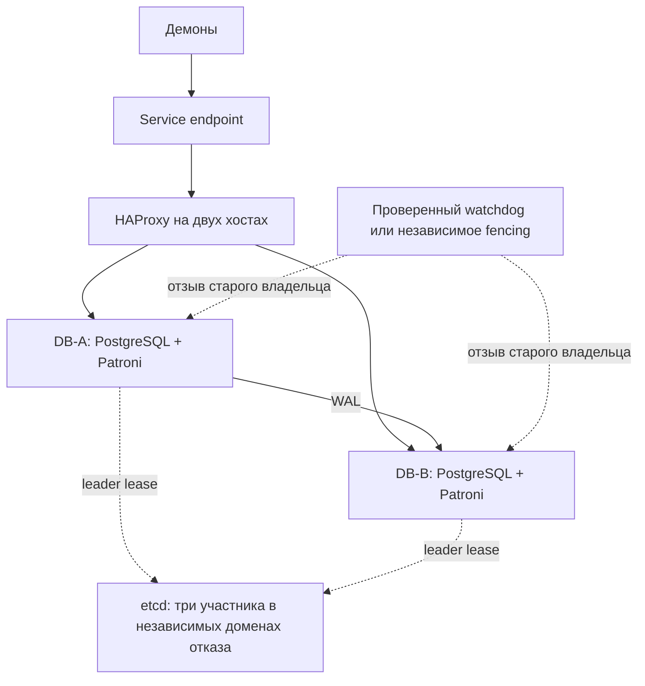
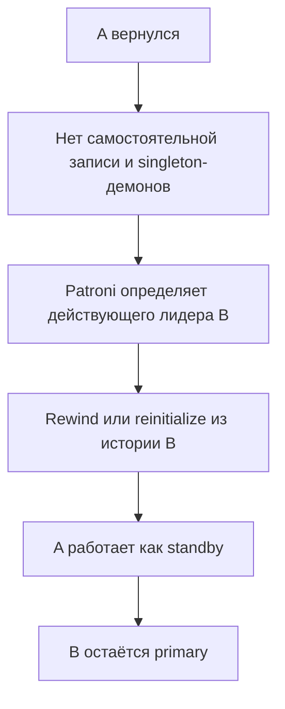

# 01. Patroni + etcd + защита прежнего primary + HA endpoint

## Соответствие требованиям

Вариант реализует [целевое поведение](00-required-behavior.md): автоматический failover, запись на единственной копии после безопасного promotion и возврат старого primary как standby без failback.

Patroni управляет PostgreSQL и ролями через leader lease в DCS. В данной архитектуре используется etcd с большинством 2 из 3. В отличие от двухузлового Pacemaker, здесь нужен независимый третий домен отказа для кворума. Три участника etcd на двух физических хостах не позволяют пережить потерю любого из них. Двухучастниковый etcd теряет кворум при отказе одного участника.

## Состав



Два proxy могут размещаться на DB-хостах, если это соответствует ресурсам и модели отказов; два отдельных proxy-сервера не обязательны. Service VIP на proxy управляется Keepalived. Альтернативный endpoint возможен, но должен следовать за подтверждённой ролью.

HAProxy проверяет документированный primary endpoint Patroni, а не только TCP/5432. REST API и DCS доступны только разрешённым компонентам. Proxy не принимает решение о promotion.

## Безопасность и последовательность failover

```mermaid
sequenceDiagram
    participant A as Старый primary A
    participant W as Watchdog / fencing
    participant E as etcd quorum
    participant B as Кандидат B
    participant H as Endpoint и демоны
    A--xE: Нельзя продлить право лидера
    A->>A: Patroni прекращает работу primary
    alt Управляющий процесс или ОС не выполнили остановку
        W->>A: Гарантированная изоляция в пределах протокола
    end
    E->>E: Прежнее право истекло
    B->>E: Получить эксклюзивное право по политике failover
    alt Кандидат пригоден и старый владелец гарантированно не пишет
        B->>B: Promotion; разрешить запись без standby
        H->>B: Проверка роли и открытие endpoint
        H->>H: Разрешить singleton-задачи у нового владельца
    else Безопасность или пригодность не доказана
        B->>B: Не открывать writable primary
    end
```

Диаграмма показывает требуемые гарантии, а не отдельный встроенный RPC для проверки питания старого primary. Истечение lease само по себе не доказывает остановку PostgreSQL при зависании. Защита должна гарантировать прекращение старой записи до открытия новой.

Для модели зависаний можно использовать поддерживаемый Patroni аппаратный watchdog в режиме `required`, с проверенными TTL, `loop_wait`, `retry_timeout` и safety margin. Альтернатива — независимое fencing, безопасно связанное с допуском к promotion. Если таких гарантий нет, автоматический failover для соответствующего сценария не соответствует требованиям.

## Политика репликации и одиночной записи

- Async допускает потерю последних подтверждённых на A транзакций; RPO согласуется отдельно.
- При sync в нормальном режиме подтверждения должны соответствовать выбранной политике сохранности.
- После безопасного promotion B должен принимать запись без standby. Постоянный `synchronous_mode_strict`, блокирующий одиночную запись, не является целевой политикой.
- Подобрать поддерживаемый режим и проверить, как выбранная версия снимает требование отсутствующей sync-реплики. Non-strict synchronous mode допускает работу без sync standby, но при этом подтверждения в одиночном режиме больше не имеют второй копии.
- `maximum_lag_on_failover` ограничивает выбор кандидата, но не обещает точный RPO в секундах/байтах. WAL и статистика обновляются с интервалами.
- Точное поведение при потере только standby определяется согласованной sync/async-политикой. Оно должно быть явным, без скрытого обещания RPO=0.

## Демоны и возврат узла

PostgreSQL запускается только через Patroni. Любой старт узла не должен самостоятельно восстанавливать writable-роль.

Patroni может вернуть бывший primary как replica через rewind/reinitialize при выполненных prerequisites. Нужно настроить и проверить автоматический путь восстановления, включая отсутствие WAL, расходящуюся историю и сохранение данных для расследования. Автоматического failback нет.



Patroni не является универсальным менеджером произвольных демонов. Их запуск и отзыв должны быть связаны с действующим правом владельца; одной проверки `pg_is_in_recovery()` или VIP недостаточно. При необходимости изоляция старого узла должна останавливать и его демоны.

## Краевые случаи

| Событие | Результат |
|---|---|
| Primary упал | Безопасный promotion пригодного standby; одиночная запись разрешена |
| Primary виден клиентам, но не DCS | Demotion/защита от зависаний до открытия нового primary |
| Потерян кворум etcd | В консервативной политике primary прекращает запись, новый не выбирается |
| Потеря только WAL-канала | Нет promotion только по отсутствию WAL; lag и sync-состояние видимы |
| Proxy или VIP отказал | Восстановление endpoint; роли БД не меняются только из-за этой ошибки |
| Старый primary вернулся | Только replica; rewind/reinitialize, без failback |

DCS failsafe mode — отдельная политика, которую нужно анализировать и испытывать. Базовый вариант выше описан без него; обещание продолжать работу при любой потере DCS недопустимо.

## Плюсы и ограничения

Плюсы: специализированная автоматизация PostgreSQL, наблюдаемость ролей, механизмы восстановления реплик. Ограничения: независимый кворум, эксплуатация DCS и защиты зависаний, отдельная интеграция endpoint и демонов. Для ограничения строго двумя физическими хостами без внешнего кворума данный вариант не является основным.

Источники: [Patroni](https://patroni.readthedocs.io/en/latest/), [replication modes](https://patroni.readthedocs.io/en/latest/replication_modes.html), [watchdog](https://patroni.readthedocs.io/en/latest/watchdog.html), [DCS failsafe](https://patroni.readthedocs.io/en/latest/dcs_failsafe_mode.html), [etcd quorum](https://etcd.io/docs/v3.5/faq/). Параметры сверяются с выбранными версиями; онлайн-проверка источников не выполнялась.
