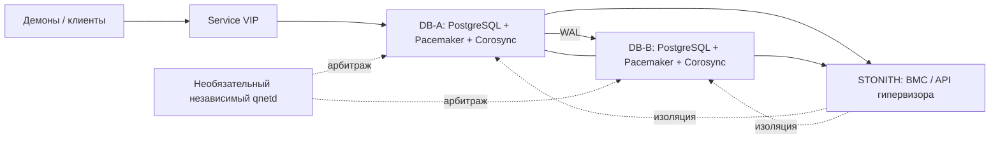
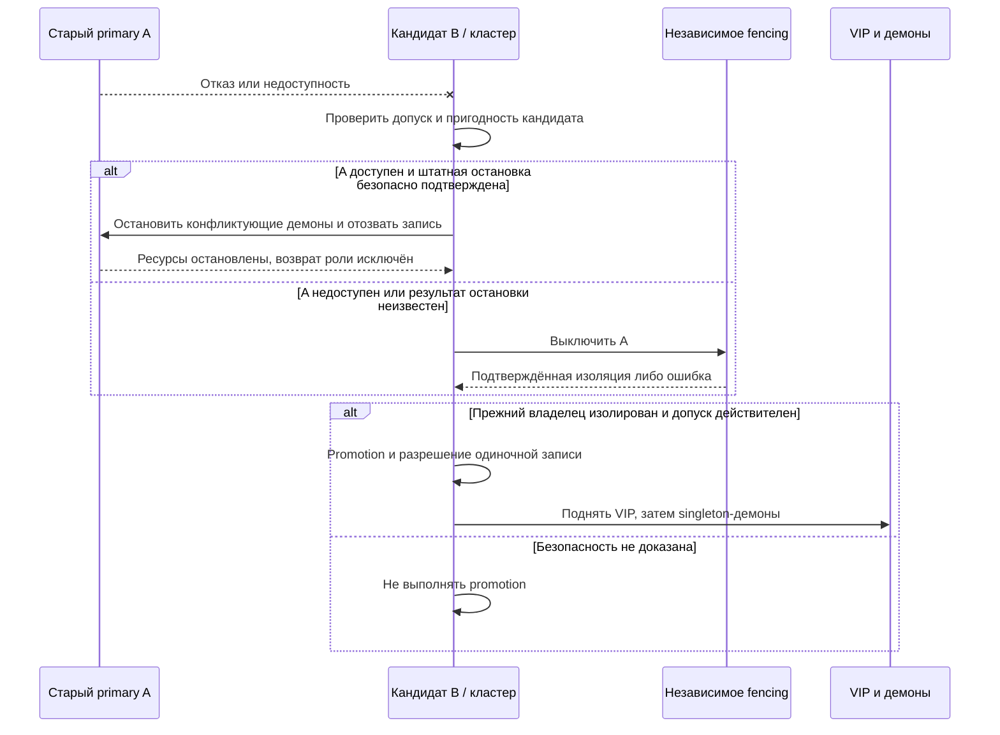
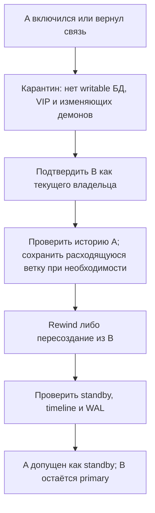

# 02. Два узла: Pacemaker + Corosync + STONITH + VIP

## Соответствие требованиям

Целевая модель описана в [требованиях](00-required-behavior.md): автоматическое переключение, запись на одной копии после failover, возврат прежнего primary только как standby и отсутствие автоматического failback.

Pacemaker управляет PostgreSQL, VIP и singleton-демонами как кластерными ресурсами. Corosync обеспечивает membership. Для двух DB-узлов отдельный наблюдатель не обязателен: возможна двухузловая конфигурация с проверенным STONITH. Qdevice/qnetd на независимом третьем хосте — дополнительный вариант улучшения арбитража, а не обязательный компонент базовой схемы.

Это первый кандидат для двух серверов в одной LAN, если требуется переключать весь комплект БД и демонов. Два узла сами по себе не обеспечивают безопасность: обязательны корректный допуск к promotion и подтверждённое прекращение работы прежнего владельца.

## Состав

Нужен совместимый PostgreSQL resource agent, поддерживающий streaming replication и promotion, например PAF (`ocf:heartbeat:pgsqlms`). Его поведение, поддерживаемые версии и возможности восстановления проверяются до внедрения.

При общем L2 Pacemaker управляет VIP через подходящий IP-агент. Параллельный Keepalived для того же адреса не используется. Для разных L3-сегментов потребуется отдельная интеграция endpoint.

## Безопасное переключение

Это требуемая последовательность ресурсов; конкретные переходы определяются агентами. Сетевое уведомление не заменяет проверенную остановку. Если A не отвечает, кандидат может повторять попытки с timeout/backoff, но ожидание не даёт права на promotion.

## Настройки и интеграция

- Спроектировать `two_node`, votes, quorum, startup fencing и политику потери quorum совместно по документации выбранного дистрибутива. Не копировать универсально `no-quorum-policy=ignore`.
- Проверить встречное fencing при partition: приоритеты и задержки должны исключать небезопасный допуск. Двойное отключение допустимо как безопасный исход, но ухудшает доступность.
- STONITH должен подтверждать результат, а не только отправку команды. Учитывать автоматический перезапуск VM, питание по нескольким вводам и доступность management-сети.
- Promotion → VIP → singleton-демоны. Штатная остановка: демоны → VIP → отзыв роли/остановка БД. При аварии graceful ordering заменяется подтверждённой изоляцией.
- Исключить самостоятельный writable-запуск БД и демонов из systemd/cron в обход кластера.
- После failover запись без standby разрешается. Если в норме используется sync-репликация, агент/интеграция должны безопасно менять требование подтверждения для одиночной работы. Проверить фактическое поведение: сам Pacemaker не задаёт политику RPO.
- Точные правила при потере только standby и допустимую потерю последних транзакций при async согласовать отдельно. Запись после безопасного promotion не должна ждать восстановления второй копии.

## Возврат прежнего primary

Автоматический rejoin — отдельное требование к выбранному агенту и интеграции. Нельзя считать, что любой PostgreSQL-агент уже выполняет rewind/reclone. Если он этого не делает, нужна автоматизация восстановления с журналом операции, проверками и безопасными повторами. Location preferences не должны вызывать автоматический failback.

## Краевые случаи и проверка

| Событие | Результат |
|---|---|
| Primary выключен или завис | Fencing подтверждён → promotion → запись на одной копии |
| Межузловой partition | Допуск и fencing по политике; без безопасного победителя — простой |
| Fencing недоступно или timeout | Promotion запрещён |
| Отказ общего сетевого устройства | Нет необоснованного promotion; возможна общая недоступность |
| Старый primary вернулся | Только карантин и standby; VIP не возвращается автоматически |
| Сбой во время переключения | Проверить фактические ресурсы и безопасно продолжить; не включать старый узел вслепую |

Контролировать владельца, quorum, fencing history, ресурсы, lag, одиночный режим и состояние демонов. Общие испытания перечислены в [README](../README.md).

## Плюсы и ограничения

Плюсы: два DB-хоста без обязательного наблюдателя; единое управление БД, VIP и демонами; развитые механизмы STONITH. Ограничения: сложная конфигурация quorum/constraints; зависимость от resource agent и надёжного fencing; автоматический rejoin может потребовать разработки.

Источники: [Pacemaker](https://clusterlabs.org/projects/pacemaker/doc/), [PAF](https://clusterlabs.github.io/PAF/), [fence agents](https://github.com/ClusterLabs/fence-agents), [Corosync qdevice](https://github.com/corosync/corosync-qdevice). Конкретные параметры сверяются с выбранными версиями; онлайн-проверка источников не выполнялась.
