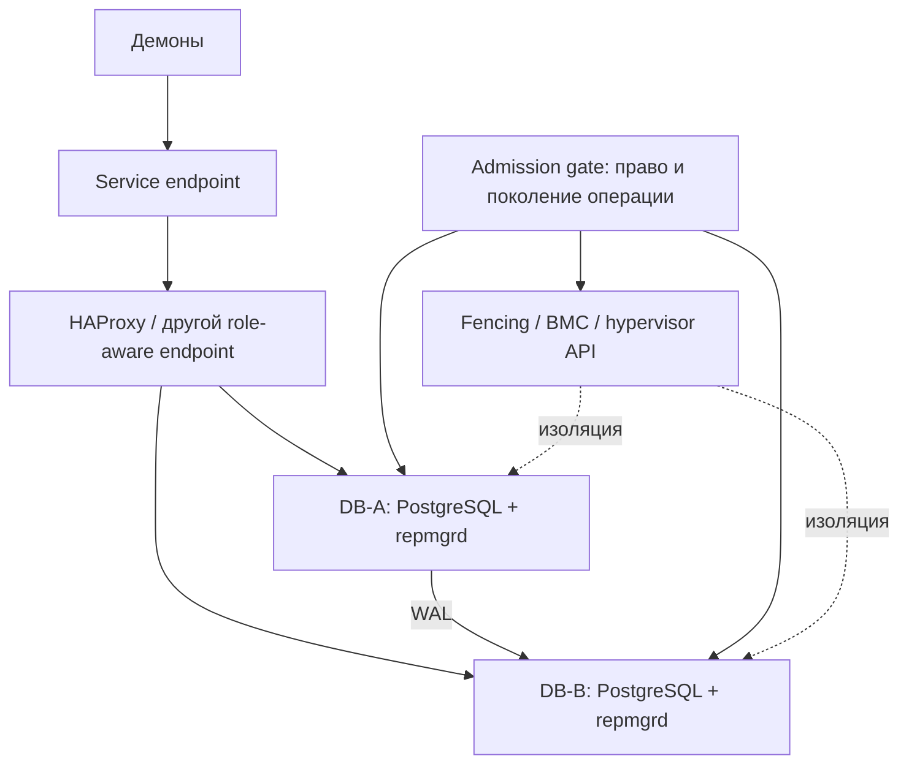
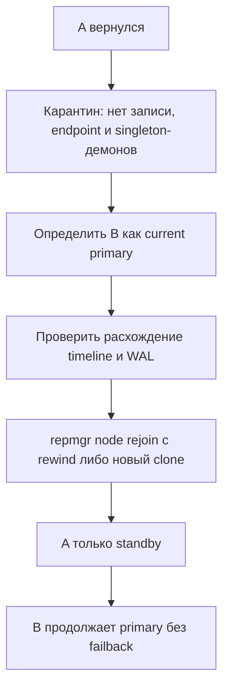

# 03. repmgr/repmgrd + собственная политика допуска + fencing

## Соответствие требованиям

repmgr предоставляет операции PostgreSQL, но не является готовым решением всех требований безопасности. В целевой модели standby автоматически становится primary после подтверждённого отзыва роли старого владельца, продолжает запись без standby, а вернувшийся узел становится replica без failback.

repmgr можно использовать как основу для репликации, promotion и rejoin. Логику эксклюзивного допуска, safe demotion, fencing, endpoint и singleton-демонов нужно связать самостоятельно.



Witness не является fencing и не гарантирует, что старый primary прекратил запись. Он может улучшить оценку видимости, но при двух физических узлах остаётся дополнительным компонентом, а не обязательным условием описанной схемы.

## Протокол допуска к promotion

```mermaid
sequenceDiagram
    participant B as Кандидат B
    participant A as Старый primary A
    participant G as Admission gate
    participant F as Fencing
    participant V as Endpoint
    B->>G: Запрос failover с operation_id и поколением
    G->>A: Запросить demote и отзыв старой роли
    alt A отвечает и подтверждает устойчивый demote
        G->>G: Проверить фактическое отсутствие записи A
    else Нет ответа или состояние неизвестно
        G->>F: Изолировать A
        F-->>G: Результат fencing
    end
    alt A больше не может писать, допуск B эксклюзивен
        G->>B: Разрешить repmgr promote
        B->>B: Стать primary; работать без standby
        B->>V: Открыть role-aware endpoint
    else Гарантии нет
        G-->>B: Promotion запрещён
    end
```

Gate должен считать отправку команды и подтверждённый результат разными состояниями. Ответ A должен запрещать возврат старой роли после паузы/перезапуска; простого `pg_is_in_recovery()` недостаточно. Команды привязываются к поколению роли, чтобы запоздалая операция прошлого failover не изменила текущего владельца.

Если A не отвечает, B может повторять попытки с timeout/backoff, но отсутствие ответа не является подтверждением. Для автоматического обработки такого случая необходимо fencing или иной механизм, доказывающий прекращение записи A и действий его демонов.

## Настройка

1. Развернуть streaming replication и регистрацию узлов по документации версии repmgr.
2. Настроить repmgrd для наблюдения и штатных действий, не выдавая ему право обходить admission gate.
3. Все пути `promote`, ручные и автоматические, провести через один gate с durable журналом.
4. Проверять timeline, lag и пригодность B до promotion. Если допустим async RPO, явно фиксировать потенциальную потерю последних транзакций.
5. После promotion B разрешить запись без standby; мониторинг должен показывать деградированный режим и отсутствие второй копии.
6. HA endpoint направляет новые подключения только на разрешённый current primary. Проверка только `pg_is_in_recovery() = false` не защищает от двух primary.
7. Ограничить прямые подключения демонов к IP узлов и локальным socket либо подчинить их той же проверке роли.
8. Keepalived/VRRP может переносить VIP, но не вызывает promotion и не является admission gate.
9. Не запускать PostgreSQL writable через независимый systemd/cron.

## Возвращение узла



Доступность `repmgr node rejoin` и prerequisites для rewind проверяются в выбранном релизе. Если история расходится, divergent WAL не сливается автоматически; нужные данные сохраняются для расследования до пересоздания standby.

## Краевые случаи

| Событие | Реакция |
|---|---|
| A выключен и fencing подтверждён | Gate разрешает promotion B и одиночную запись |
| A жив, но недоступен B | Нет promotion до demote/fencing; возможен простой |
| Потерян только replication-канал | Не считать A мёртвым; B не продвигается по одному timeout |
| Gate или fencing недоступен | Promotion запрещён |
| Потерян witness | Не считать это доказательством права B; применять основную политику допуска |
| A вернулся | Карантин, rejoin/clone, standby; автоматического failback нет |
| Ошибка после fencing до promotion | Сохранить изоляцию A, восстановить операцию по журналу; не включать A ради доступности |

## Плюсы и ограничения

Плюсы: относительно небольшой стек PostgreSQL, развитые команды clone/follow/rejoin, гибкие hooks. Ограничения: безопасный автоматический failover требует собственной реализации gate, поколения операций, fencing и интеграции демонов. Witness не заменяет эту работу.

Если команда не готова сопровождать admission gate и испытания всех промежуточных отказов, лучше выбрать Pacemaker либо Patroni с проверенной защитой.

Источники: [repmgr](https://www.repmgr.org/docs/current/), [repmgrd network split](https://www.repmgr.org/docs/current/repmgrd-network-split.html), [witness](https://www.repmgr.org/docs/current/repmgrd-witness-server.html). Имена hooks и их семантика сверяются с выбранной версией; онлайн-проверка источников не выполнялась.
