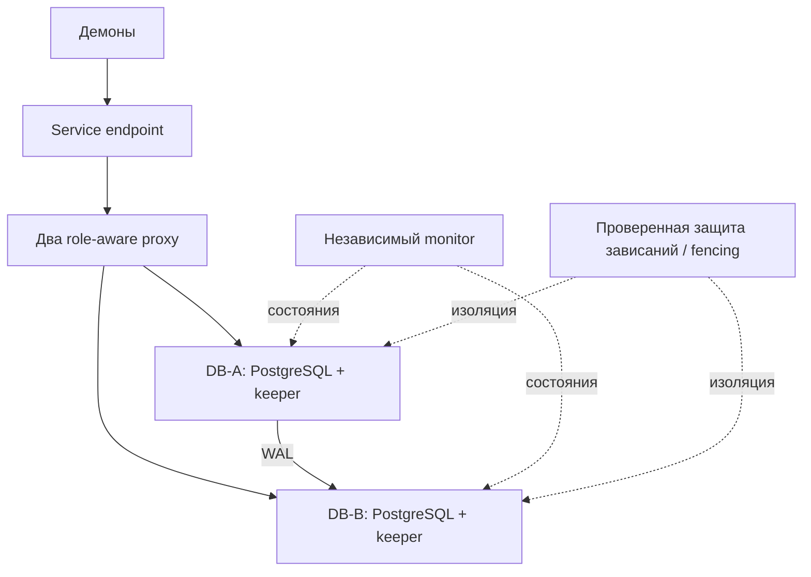
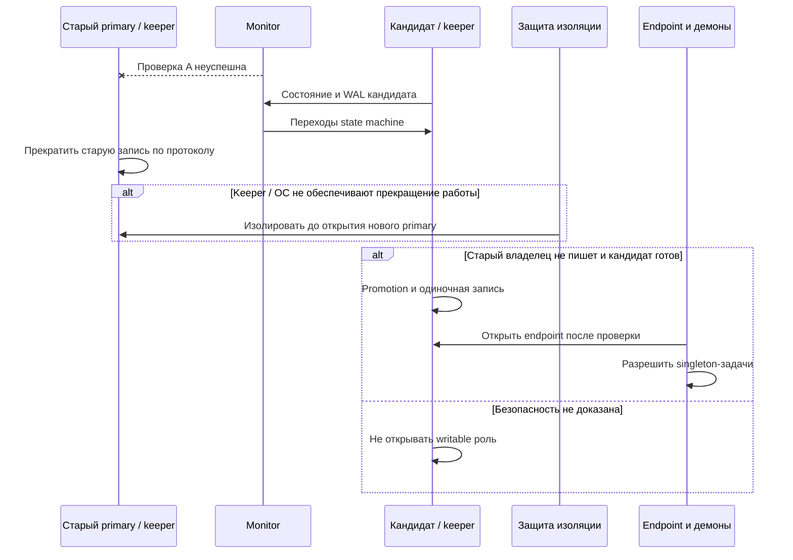
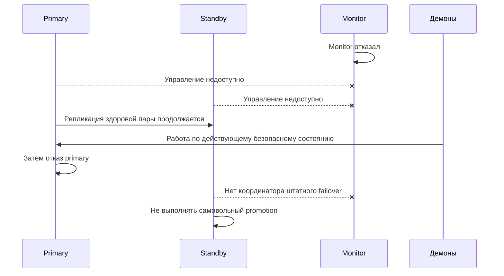

# 04. pg_auto_failover: monitor + keepers + HA endpoint

## Соответствие требованиям

pg_auto_failover использует отдельный PostgreSQL monitor с extension и keeper (`pg_autoctl`) на каждом DB-узле. Monitor назначает состояния, keepers выполняют переходы ролей и репликации.

Целевая модель — [требования](00-required-behavior.md): новый primary автоматически продолжает запись на одной копии после безопасного переключения; старый узел возвращается только как standby без failback.

Для штатного автоматического failover требуется monitor. Поэтому этот вариант не соответствует ограничению «только два хоста без наблюдателя». Monitor на одном DB-хосте создаёт зависимость управления от потери этого хоста. Он не является трёхузловым consensus-кластером и сам по себе не доказывает выключение старого primary.

## Состав

Proxy могут быть совмещены с другими хостами при подходящей модели отказов. Keepalived управляет VIP на proxy, но не решает, кто станет primary. Endpoint учитывает роль и допустимое состояние keeper, а не только доступность TCP/5432.

## Протокол переключения и защита зависаний

Диаграмма задаёт необходимый инвариант, а не утверждает наличие встроенного STONITH или универсального hook в pg_auto_failover. Требуется проверить фактические переходы выбранной версии и возможность безопасно связать их с внешней защитой. Fencing после обнаружения двух primary слишком поздно.

Если keeper завис, а PostgreSQL продолжает принимать записи, одно назначение новой роли monitor недостаточно. Watchdog/fencing должен гарантировать прекращение старой работы до разрешения новой. Если такую интеграцию нельзя обеспечить, автоматический failover для этой модели отказа не соответствует требованиям.

## Репликация и одиночная работа

Выбрать candidate priority, синхронную политику и режим работы при отсутствии peer по возможностям версии.

Требуемый результат: после безопасного promotion B принимает записи без A. Проверить, что state machine действительно переводит его в одиночное состояние и не оставляет подтверждения транзакций заблокированными ожиданием отсутствующего standby.

В нормальном состоянии sync может защищать подтверждённые транзакции на обеих копиях; async допускает потерю последних commit. Одиночные записи после failover имеют одну копию. Это показывается как деградированный режим без обещания RPO=0 при следующем отказе.

## Потеря monitor

Работа здоровой пары без monitor и сочетание потери monitor с partition — разные сценарии. Поведение защиты при двойном отказе проверяется отдельно. Восстановление monitor не должно создавать два одновременно действующих управляющих экземпляра; нужны резервирование данных и проверенный runbook.

## Возврат узла и демоны

Старый A не запускает PostgreSQL writable в обход keeper. Он проходит состояния восстановления, rewind/reclone при выполненных prerequisites и становится standby текущего B. Автоматический failback не нужен; настройки приоритетов не должны его вызывать.

Автоматический возврат должен быть проверен при отсутствии нужных WAL и расхождении истории. Сбой восстановления оставляет A в безопасном состоянии, а B продолжает одиночную работу.

Singleton-демоны не управляются универсально monitor. Нужна отдельная интеграция их запуска и отзыва с правом текущего владельца, включая изоляцию прежних процессов и защиту от повторных внешних действий.

## Краевые случаи

| Событие | Результат |
|---|---|
| Primary отказал, monitor доступен | Штатная state machine плюс доказанное прекращение старой записи; новый primary работает один |
| Keeper завис при живой БД | Независимая защита до открытия нового primary; без неё переключение блокируется |
| Monitor недоступен, пара здорова | Работа по безопасному текущему состоянию; автоматическое управление ограничено |
| Monitor и primary недоступны | Нет самовольного promotion; восстановление управления или отдельный безопасный аварийный протокол |
| Старый primary вернулся | Keeper восстанавливает standby, без возврата endpoint и failback |
| Endpoint отказал | Исправить подключение, не менять роль БД только из-за endpoint |

## Плюсы и ограничения

Плюсы: специализированная state machine PostgreSQL, автоматизированные переходы репликации. Ограничения: обязательный monitor для штатного управления, отдельная интеграция endpoint и демонов, проверка защиты при зависании keeper. Для текущего ограничения двумя хостами менее прямой выбор, чем Pacemaker.

Источники: [documentation](https://pg-auto-failover.readthedocs.io/en/main/), [architecture](https://pg-auto-failover.readthedocs.io/en/main/architecture.html), [fault tolerance](https://pg-auto-failover.readthedocs.io/en/main/fault-tolerance.html). Переходы, поддерживаемые версии и параметры сверяются перед реализацией; онлайн-проверка источников не выполнялась.
